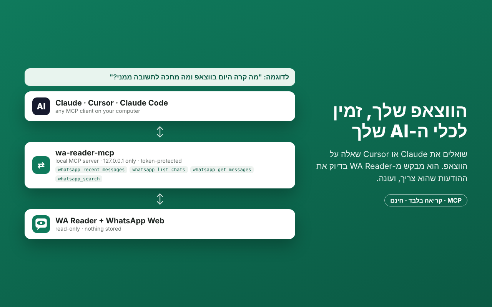

# WA Reader

**סיכום יומי של WhatsApp Web – קריאה בלבד, חינם, קוד פתוח.**
**A read-only daily digest of WhatsApp Web – free and open source.** [English ↓](#english)

תוסף כרום שקורא את ההודעות שלך ב-WhatsApp Web, מסדר אותן לפי שיחה, ומסמן מה מחכה לתשובה ממך. בלחיצה אחת אפשר להעתיק את הכול לסיכום ב-Claude, ב-ChatGPT או ב-Gemini.



## למה אפשר לסמוך עליו
- **קריאה בלבד.** ברגע שהתוסף מתחבר, הוא לוקח רק 6 פונקציות קריאה ומוחק מהדף את כל הממשק של הספרייה, כולל שליחה, מחיקה וסימון כנקרא. אין בקוד אף קריאה שכותבת ל-WhatsApp. ראו [`extension/page/page.js`](extension/page/page.js).
- **הכול נשאר אצלך.** ההודעות נשמרות ב-IndexedDB בדפדפן שלך בלבד. אין שרת, אין אנליטיקס ואין מעקב. ה-Google Analytics ש-WA-JS מפעילה כברירת מחדל כבוי ([`config.js`](extension/page/config.js)).
- **שום דבר לא קורה בלי הסכמה.** עד שמאשרים במסך ההפעלה, התוסף לא מזריק שום קוד ל-WhatsApp Web. כיבוי בהגדרות מנתק אותו ומוחק את כל הנתונים.
- **בלי וי כחול.** הקריאה נעשית מהזיכרון של הדף ולא מסמנת הודעות כנקראו.

## התקנה
- **מחנות Chrome:** הקישור יתווסף כאן אחרי אישור החנות.
- **מהקוד:** מורידים את הריפו, פותחים `chrome://extensions`, מפעילים Developer mode, לוחצים Load unpacked ובוחרים את התיקייה `extension`.

## אפשרויות
- סינון לפי היום, אתמול, 7 ימים או תאריך מסוים, לפי קבוצות, ולפי "רק ממתינות לי".
- העתקה לסיכום ב-AI, או ייצוא ל-Markdown ול-JSON.
- ייצוא יומי אוטומטי לקובץ בתיקיית ההורדות.
- החרגת שיחות, כך שהן לא נשמרות בכלל.
- Webhook אופציונלי, למשל ל-Make, n8n או Supabase, לחיבור לאוטומציות שלך.

## איך זה עובד
| קובץ | תפקיד |
|---|---|
| `background.js` | הסכמה, רישום הסקריפטים רק אחרי אישור, סנכרון, שמירה, ייצוא ו-webhook |
| `bridge.js` | גשר בין הדף לתוסף |
| `page/page.js` | קורא הודעות דרך [WA-JS](https://github.com/wppconnect-team/wa-js) ונועל את פונקציות השינוי |
| `page/wppconnect-wa.js` | WA-JS (Apache 2.0), מוטמע בתוסף כמו שהוא, בלי קוד שנטען מרחוק |
| `ui/` | מסך הפעלה, חלון קופץ, דף סיכום, הגדרות ומדיניות פרטיות |

## כשווצאפ מתעדכן ומשהו נשבר
```bash
./scripts/update-wa-js.sh   # מושך את WA-JS העדכני מ-npm
./scripts/package.sh        # בונה ZIP להעלאה לחנות
```

## חשוב לדעת
התוסף לא קשור ל-WhatsApp או ל-Meta ולא מאושר על ידן. הוא משתמש בדרך לא רשמית כדי לקרוא נתונים מתוך WhatsApp Web. השימוש באחריותך. [מדיניות פרטיות](https://kobibest.github.io/wa-reader/privacy.html)

## מי בנה את זה

<a href="https://digital.m-eitan.co.il/?utm_source=github&utm_medium=readme&utm_campaign=wa-reader"></a>

**[איתן | דיגיטציה ארגונית](https://digital.m-eitan.co.il/?utm_source=github&utm_medium=readme&utm_campaign=wa-reader)** – קובי איתן.
אני בונה לעסקים מערכות, אוטומציות וסוכני AI שחוסכים עבודה ידנית. צריכים סיכום שמגיע אוטומטית כל בוקר, חיבור של הווצאפ ל-CRM, או אוטומציה אחרת לעסק? [לשיחת ייעוץ ראשונית חינם](https://digital.m-eitan.co.il/?utm_source=github&utm_medium=readme&utm_campaign=wa-reader#contact)

---

<a id="english"></a>
## English

WA Reader is a Chrome extension that reads your WhatsApp Web messages, groups them by chat, flags what is waiting for your reply, and lets you copy everything into any AI for a summary.

- **Read-only by construction.** Once WhatsApp loads, the extension captures six read functions and deletes the WA-JS global from the page, so nothing on the page can send, delete or mark messages as read.
- **Local-only.** Messages are stored in your browser's IndexedDB. There is no server, analytics or tracking. An optional webhook sends data only to an address you choose.
- **Consent first.** Nothing is injected into WhatsApp Web until you agree on the welcome screen. Turning the extension off detaches it and wipes all data.

**Install from source:** `chrome://extensions` → Developer mode → Load unpacked → select the `extension` folder.

Built by [Kobi Eitan – Eitan | Organizational Digitization](https://digital.m-eitan.co.il/?utm_source=github&utm_medium=readme&utm_campaign=wa-reader). Not affiliated with WhatsApp or Meta. Uses [WA-JS](https://github.com/wppconnect-team/wa-js) (Apache 2.0). Code is MIT-licensed. [Privacy policy](https://kobibest.github.io/wa-reader/privacy.html).
